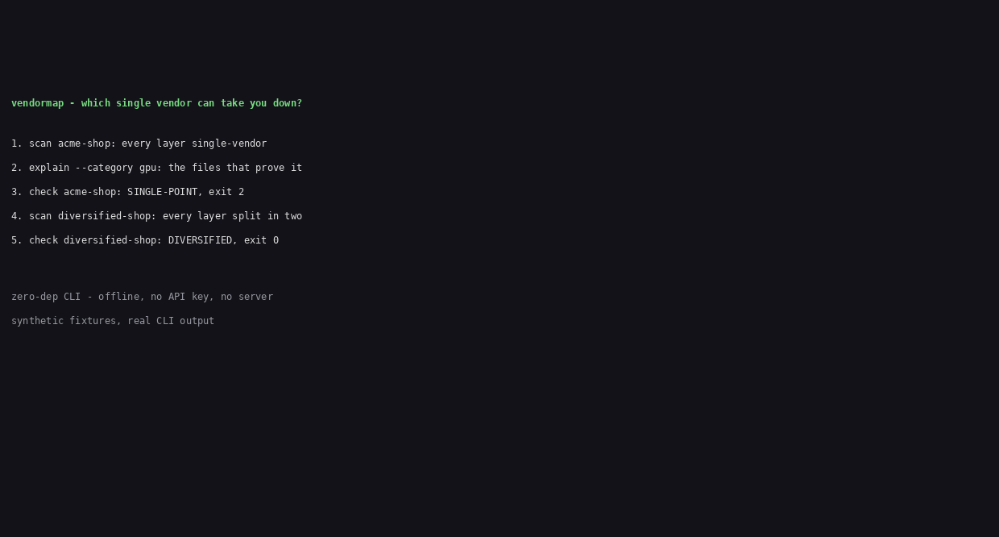

# vendormap

Map your vendors from your own repo. One command shows which single vendor can take each layer of your stack down.

For teams who run on one cloud, one GPU vendor, one model provider - and want to see that concentration before the vendor has a bad day.



## Why this exists

On 12 November 2026 NVIDIA announced that Jensen Huang had resigned as President, CEO and board member, effective immediately (board accepted the resignation 11 November, per the company's Form 8-K; reported by Reuters, AP and TechCrunch the same day). CFO Colette Kress, CFO since 2013, became interim CEO, and Harvey C. Jones became the company's first board chair. Shares fell nearly 10% in premarket trading (Mathrubhumi, 12 November 2026). Q3 FY2027 earnings are still scheduled for 17 November 2026. The board opened an independent investigation on 8 November; the company says it currently has no reason to believe company secrets or US national security were compromised, and the espionage allegations remain disputed and unproven - keep that line separate from the confirmed facts above.

The same week, a Microsoft/Azure outage took down every customer at once (Hacker News front page, 13 November 2026). The operator's question is not gossip about the CEO. It is: how much of MY stack depends on ONE vendor, in each layer, and what breaks first if that vendor has a bad day?

SBOM tools list packages. Cloud cost tools track spend. Vendor-risk platforms read questionnaires and DPAs. None of them read your repo - the Terraform, manifests and code where the dependency actually lives. vendormap does that, locally, in one command.

## Install

vendormap is not on npm yet (the name is free; v0.1.0 installs from source). Node 20+ required, zero runtime dependencies.

```sh
git clone https://github.com/techdevfun/vendormap.git
cd vendormap
npm install
npm run build
```

Clean install from source, measured 13 November 2026: `npm install + npm run build` took 4.4 s (no cache).

Then run it from the repo root, or link it: `npm link` makes `vendormap` available everywhere.

## Usage

```sh
vendormap init                        # scaffold vendormap.json in this dir
vendormap scan <dir>                  # table report (exit 0 always)
vendormap scan <dir> --format json    # full evidence: paths + line numbers + counts
vendormap check <dir>                 # CI gate: exit 0/1/2
vendormap explain <dir> --category gpu
vendormap diff --baseline scan.json <dir>
```

### Worked example (real output, synthetic fixture)

`examples/acme-shop` is a synthetic SaaS that runs on NVIDIA GPUs, AWS, OpenAI, Cloudflare and Stripe - every layer single-vendor. Its scores are the fixture's own, not measurements of any real company.

```sh
$ vendormap scan examples/acme-shop

CATEGORY     VENDOR           REFS  SHARE  SCORE  VERDICT       TOP FILES
cloud        aws              8     100%   100    SINGLE-POINT  .env.example, package-lock.json
gpu          nvidia           3     100%   100    SINGLE-POINT  k8s/deployment.yaml, src/app.py
model        openai           4     100%   100    SINGLE-POINT  .env.example, package-lock.json
registry     ecr              3     100%   100    SINGLE-POINT  Dockerfile, k8s/deployment.yaml
identity     auth0            4     100%   100    SINGLE-POINT  .env.example, package-lock.json
dns-cdn      cloudflare       3     100%   100    SINGLE-POINT  .env.example, terraform/main.tf
payments     stripe           4     100%   100    SINGLE-POINT  .env.example, package-lock.json
ci           github-actions   4     100%   100    SINGLE-POINT  .github/workflows/ci.yml
data         postgres         2     100%   100    SINGLE-POINT  .env.example, src/app.py

Overall concentration score: 100 (SINGLE-POINT)

$ vendormap check examples/acme-shop
check: SINGLE-POINT (exit 2)

$ vendormap scan examples/diversified-shop
Overall concentration score: 44 (DIVERSIFIED)

$ vendormap check examples/diversified-shop
check: DIVERSIFIED (exit 0)
```

`vendormap explain` shows every reference, file by file, plus the second-source checklist for the dominant vendor:

```sh
$ vendormap explain examples/acme-shop --category gpu

Verdict: SINGLE-POINT, score 100, 3 refs total.

nvidia: 3 ref(s)
  k8s/deployment.yaml (lines 16, 22)
  src/app.py (lines 4)

Second-source options for nvidia (verified 2026-11-13; re-verify before acting):
  - AMD ROCm
  - Intel oneAPI
  - cloud TPUs
Alternatives are NOT drop-in replacements and switching costs are real.
```

## What it scans

| Source | Signals |
|---|---|
| Terraform `*.tf` | `provider` blocks, resource prefixes (`aws_`, `azurerm_`, `google_`) |
| Kubernetes YAML | image registries, cloud annotations, ingress/provider fields |
| `Dockerfile*` | `FROM` registries (docker.io, ghcr.io, ECR, GCR, ACR) |
| `package.json` (+ lockfiles, names only) | registry hosts, vendor SDK packages |
| `.github/workflows/*.yml` | `uses:` actions, `runs-on:` labels |
| Code imports `.ts/.js/.py` | model-provider SDKs, cloud SDKs, payment and identity SDKs |
| Env-file NAMES only | keys like `OPENAI_API_KEY` prove a provider is wired in |

Categories: cloud, gpu, model, registry, identity, dns-cdn, payments, ci, data. Unknown vendors are reported as `unknown` with their raw reference - never silently dropped, never auto-classified.

## Scoring (a concentration heuristic, not a risk measurement)

Per category: `share = dominant vendor refs / total refs`; `score = round(100 * share^2)` (Herfindahl-style, 0-100).

- 0 refs: `NOT-DETECTED` - the layer is absent or unreadable, said plainly, never scored 0.
- 1 ref total: `THIN` - not enough evidence, not a verdict.
- One vendor with 2+ refs: `SINGLE-POINT`, regardless of score.
- Otherwise: score at or above the threshold (default 50, overridable per category in `vendormap.json`) is `CONCENTRATED`, else `DIVERSIFIED`.

Overall score = worst category score. Overall verdict = worst category verdict. The stack is as concentrated as its weakest layer - documented, not averaged away. Thresholds, per-category weights and an allowlist live in `vendormap.json` (see `vendormap init`); weights are reserved for a future weighted rollup and do not change the v0.1.0 overall score.

`check` is the CI gate: exit 0 DIVERSIFIED, 1 CONCENTRATED, 2 SINGLE-POINT (or any category score over `--max-score`). `diff` compares against a saved `scan --format json` baseline and exits 1 when a category got worse past the threshold.

## Privacy: what vendormap never touches

- Never reads, prints or stores env VALUES or file contents. Output contains file paths, line numbers and counts only.
- Real `.env` files, `*secret*` files, `*.pem` and `*.key` files are skipped entirely. Only `.env.example` / `.env.sample` / `.env.template` files are read, and only for KEY NAMES (the text left of the first `=`); values are discarded unread.
- Lockfiles are parsed for package NAMES only.
- No API calls, no network, no upload. It runs fully offline.

## Where rivals beat us

- **RiskBee** (riskbee.co, $99, checked 13 November 2026) actually computes concentration risk across a whole client portfolio, with blast-radius search and 4th-party sub-processor extraction from DPAs. It reads paperwork, not your repo; it is SaaS, needs onboarding and a subscription, and has no local CLI or CI gate.
- **MeasuredRisk** (measuredrisk.com, checked 13 November 2026) sees financial health, sanctions, geopolitics and multi-tier supplier concentration across portfolios. It is an enterprise SaaS and intelligence service, not a local tool that reads code.
- **Radiatus Vendor Risk Tiering Calculator** (updated 11 October 2026) tiers one vendor on five dimensions vendormap does not measure (criticality, substitutability, assurance, location). It is manual judgement input, one vendor at a time.
- **SBOM / CVE scanners (Trivy, Grype, osv-scanner, npm audit)** see vulnerabilities vendormap never looks at. They answer "is this version vulnerable?", never "is this layer single-vendor?".
- **Supply Chain Risk Auditor** (Claude Code skill) audits dependency maintenance risk (single-maintainer, stale, low popularity) and suggests drop-in replacements. Maintainer health, not vendor concentration; needs the GitHub CLI and a live agent session.
- **Ledger Summit QBO Vendor Spend Analyzer** is a free browser calculator for AP spend concentration. Finance spend only, manual data entry, no repo evidence, no CI.

vendormap's wedge: code-driven, not paperwork-driven; a local zero-dependency CLI with exit codes; deterministic and auditable (every number traces to named files); a second-source checklist in the report. It only sees what is in the files it reads - runtime-only vendors, contracts and spend are invisible to it.

Same-name note: `wimark/vendormap` is a Go library for MAC vendor-prefix lookup (2020). Same name, different domain - not a CLI, not concentration, not a rival.

## Honest limits

- A score is a concentration HEURISTIC. It is not a measurement of risk, and a low score does not mean a vendor is safe.
- Runtime-only vendors are invisible to a static scan. `scan` prints a coverage note listing which sources were found vs absent in the scanned dir.
- The alternatives table is stamped with a verification date (2026-11-13). Re-verify before acting. No switching-cost or savings numbers are given anywhere, because none were measured.
- No CVE or version data, no spend or billing data, no contracts, no sub-processor graphs, no runtime traffic analysis, no auto-remediation. Those are out of scope by design, not missing by accident.

## Roadmap

- Generic webhook notification on SINGLE-POINT (phase 2).
- Pre-commit hook example.
- More categories and vendor tables (contributions welcome - see CONTRIBUTING.md).

## Performance

Local scan over the two demo fixtures (200 runs each, 3 runs): median 2.6 ms, p95 3.7 ms. Target was p95 under 5 s on the demo fixture set.

## License

MIT. See [LICENSE](LICENSE).
